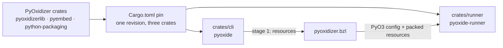

# pyoxide

Self-contained Python: one executable with an interpreter, the standard library
and native extension modules inside it, plus the tooling to put any library
next to it.

It is a small downstream of [PyOxidizer](https://github.com/indygreg/PyOxidizer):
instead of carrying ~69 k lines of build tool, this workspace depends on those
crates at one pinned revision (`Cargo.toml`, three lines) and keeps only what
they do not expose — per-package library files and a prebuilt `python`
executable.

```console
$ just runner
...
-rwxr-xr-x 1 user user 154M  pyoxide-runner
Python 3.11.18

$ dist/runner/pyoxide-runner -c 'import sys; print(sys.version)'
3.11.18 (main, Nov 10 2026, 00:00:00) [GCC ...]

$ dist/runner/pyoxide-runner -c 'import numpy; print(numpy.__version__)'
2.2.6
```

## What is in the box

| Binary | Purpose |
|---|---|
| `pyoxide` | The build tool: `package`, `package --unpack`, `build-runner`, `dist-info` |
| `pyoxide-runner` | The product: a `python`-compatible interpreter with Python inside it |

`pyoxide` is a normal Rust binary you build once. `pyoxide-runner` is built per
Python version (and per set of baked-in libraries) by `pyoxide build-runner`.

## Requirements

| Thing | Why |
|---|---|
| Rust (edition 2024, 1.85+) | building either binary |
| [`just`](https://github.com/casey/just) | the recipes below; every one is a two-line wrapper over cargo, so the raw commands work without it |
| Rust 1.99.1 | **downloaded automatically** by PyOxidizer when building the runner; it reads LLVM 23 bitcode |
| `clang` and `lld` | the runner links a bitcode `libpython` statically (Linux/macOS) |
| network | first runner build downloads its Python distribution into `~/.cache/pyoxidizer/python_distributions` |

No Python installation is needed. Everything the runner reports comes from the
embedded distribution.

## Quick start

```console
$ cargo build                                    # the `pyoxide` tool
$ just runner                                    # the runner, stdlib embedded
$ dist/runner/pyoxide-runner -c 'print("hi")'    # or: ./pyoxide-runner script.py
```

## Running Python

The runner is `python`. Every argument goes to the interpreter — `-c`, `-m`, a
script path, `-` for stdin, `-O`, `-OO`, `-B`, `-E`, `-s`, `-X`, `-W`, `-V`,
`--version`, `--help` — with the documented exit codes. No arguments starts a
REPL. Renaming the binary to `python3` changes nothing except the name printed
in `sys.argv[0]`.

The features `python` does not have live behind long options, because `-h` and
`--help` belong to the interpreter:

```console
$ pyoxide-runner --runner-help
$ pyoxide-runner --yaml app.yaml arg1 arg2     # interpreter described by YAML
$ pyoxide-runner run-yaml app.yaml -- args     # deprecated spelling
$ pyoxide-runner run-python -- args            # deprecated spelling of the default
```

A YAML config is the same document a PyOxidizer project uses, plus an
`interpreter_config` block; the file needs a line starting with `---`, `...` is
optional:

```yaml
---
interpreter_config:
  run_command: 'print("hello, world")'
...
```

## Shipping libraries

Either form goes in `pyoxide-modules/`, a directory next to the executable. The
runner scans it at startup: copy files in to add a library, delete them to
remove one. No rebuild, no environment variables.

### Packed: one file per package

```console
$ pyoxide package --dest dist/runner/pyoxide-modules requests idna
wrote dist/runner/pyoxide-modules/requests.packed-resources
wrote dist/runner/pyoxide-modules/idna.packed-resources
packaging complete: 2 package(s), nothing was skipped
```

Each package gets a packed resources file plus a `.packed-resources.json`
sidecar recording the Python version and target triple. Bytecode from another
Python fails with opaque errors, so a file whose sidecar names a different
version is skipped with a warning instead.

Packed files are loaded from memory, which means **C extension modules cannot
be loaded from them on Linux**. They are skipped at packaging time and reported:

```console
$ pyoxide package --dest dist/runner/pyoxide-modules psutil
wrote dist/runner/pyoxide-modules/psutil.packed-resources
  incomplete: 1 C extension module (s) skipped
packaging incomplete: 1 of 1 package(s) are missing resources
  psutil: 1 C extension module (s) skipped

C extension modules cannot be loaded from a packed resources file on this platform, so these packages will fail at import. Ship them as real files instead:
  pyoxide package --unpack --python-version 3.11 --dest dist/runner/pyoxide-modules psutil
```

### Unpacked: a directory per package

```console
$ pyoxide package --unpack --dest dist/runner/pyoxide-modules numpy
wrote dist/runner/pyoxide-modules/numpy/
unpacked libraries are imported from real files
```

The directory holds the wheel's files; its parent becomes a `sys.path` entry.
This is the form that carries `.so` files and real `__file__` paths:

```console
$ pyoxide-runner -c 'import numpy, numpy.linalg as l; print(numpy.__version__, l.det([[1,2],[3,4]]))'
2.2.6 -2.0
```

A `<package>.json` sidecar records the same metadata, and an unpacked directory
takes precedence over a packed file of the same name (a warning says so).

## Commands

### `pyoxide package`

```
pyoxide package [OPTIONS] <REQ>...
  --dest <DIR>            where to write, default .
  --unpack                write directories of real files instead of packed files
  --python-version <X.Y>  default: the newest the distribution list has
  --flavor <FLAVOR>       default: standalone
  --target-triple <TRIPLE> default: host
  --verbose               print pip output and every skipped resource
```

Requirements are pip's: `requests`, `lxml>=5`, `numpy==2.2.6`. Wheels only;
a package that has no wheel for the target is an error, not a silent fallback.

### `pyoxide build-runner`

```
pyoxide build-runner [OPTIONS]
  --path <DIR>             project directory containing pyoxidizer.bzl, default .
  --dest <DIR>             where to write the executable, default dist
  --exe-name <NAME>        default pyoxide-runner
  --python-version <X.Y>   Python to embed
  --requirements <STR>     space separated, baked into the executable
  --split-resources        payload in a sibling file instead of embedded
  --release                optimised runner
  --target-triple <TRIPLE> default: host
```

`--split-resources` produces a 24 MB executable plus a 132 MB
`pyoxide-resources.packed-resources` blob that it memory-maps; the two must stay
together. Without the flag it is one 154 MB file. `--requirements` bakes
packages in, which only works for what a packed file can hold: C extension
modules are skipped with a message, so ship those with `package --unpack`
instead.

The command runs two stages, and both matter when debugging a build:

1. Evaluate the `resources` target of `pyoxidizer.bzl` with the pinned
   `pyoxidizerlib`. This resolves or downloads the Python distribution and
   writes `build/<triple>/<profile>/resources/`: `pyo3-build-config-file.txt`,
   `packed-resources`, licensing.
2. Compile `crates/runner` with `PYO3_CONFIG_FILE` pointing at stage 1's config
   (and `PYOXIDE_PACKED_RESOURCES_SPLIT=1` in split mode), then copy the
   executable out.

### `pyoxide dist-info`

Prints the target triple, tags, version, extension modules and files of a
`.tar.zst` Python distribution archive from the cache.

## Project layout



```
crates/cli      pyoxide: dist-info, package, package --unpack, build-runner
crates/runner   pyoxide-runner: interpreter, --yaml, module scanning
pyoxidizer.bzl  the embedding policy: which modules, which bytecode levels
Justfile        build, test, runner, clean, upstream-*
PORTING.md      where every piece came from and why
```

`crates/runner` is deliberately **not** a default member: it cannot compile
without the PyO3 artifacts that `build-runner` produces, so a plain `cargo
build`/`cargo test` must not touch it.

## The pin, and updating it

Everything PyOxidizer comes from one revision, repeated on three lines of
`[workspace.dependencies]`. Today that revision is the fork's `fixes/upstream`
branch: the base fork plus two fixes that upstream does not have yet (bytecode
only wheels; `PyStatus_Exit` and the `cc` object name). Never `[patch]` a single
crate of that repository — cargo then holds two sources for its path
dependencies and their types stop matching.

```console
$ just upstream-status     # pin, base head, fixes head
$ just upstream-check      # exit 1 when the base fork moved past the pin
$ just fixes-rebase        # rebase the fixes onto the base fork, prints the new sha
$ just upstream-bump <rev> # move the pin; compile errors name what changed
```

The fixes are maintained on that fork and are not proposed to the base fork;
the base is consumed read-only. If a fix ever appears upstream, drop that
commit, and when the branch is empty point the three lines at
`https://github.com/ntamas/PyOxidizer`.

## CI

`.github/workflows/ci.yml` runs the tests, builds the runner (clang + lld
installed) and smoke-tests it, and on a weekly schedule runs `just
upstream-check` so a pin that falls behind the base fork turns red instead of
rotting.

## Limitations

- C extension modules cannot load from packed resources on Linux; use
  `package --unpack` for anything with a `.so`.
- `package --unpack` writes no `.dist-info`, so `importlib.metadata` does not
  see unpacked packages. Importing them works.
- `_tkinter` is not shipped: it needs shared tcl libraries the distribution
  bundles but cannot link statically.
- Verified on Linux x86_64 only. Windows/macOS paths are ported but untested.

## Troubleshooting

| Symptom | Cause |
|---|---|
| `unable to find PyOxidizer config file` | the file must be named `pyoxidizer.bzl` |
| `could not find a package in Cargo manifest` | `add_cargo_manifest_licensing` must point at `crates/runner/Cargo.toml`, not the virtual workspace root |
| `no bin target named pyoxide-runner` | the runner is outside `default-members`; `build-runner` passes `-p` |
| `resolving ar header ... No such file or directory` | the pin lost the `libpython` fix; see the pin section |
| `could not format PyStatus` on `--help` | the pin lost the `pyembed` fix; see the pin section |
| `git fetch failed for <url>` | the pinned commit is not pushed to its repository |
| runner prints `... packed-resources not found next to the executable` | split build without its blob |

## License

Mozilla Public License 2.0, the license of the PyOxidizer code this project
derives from. See `LICENSE`.
